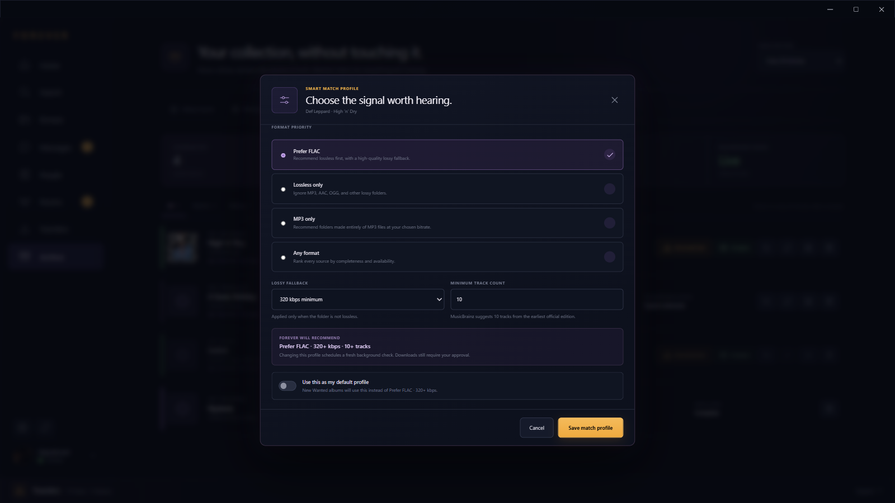
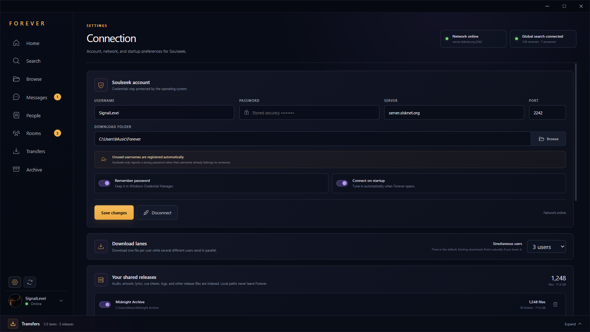
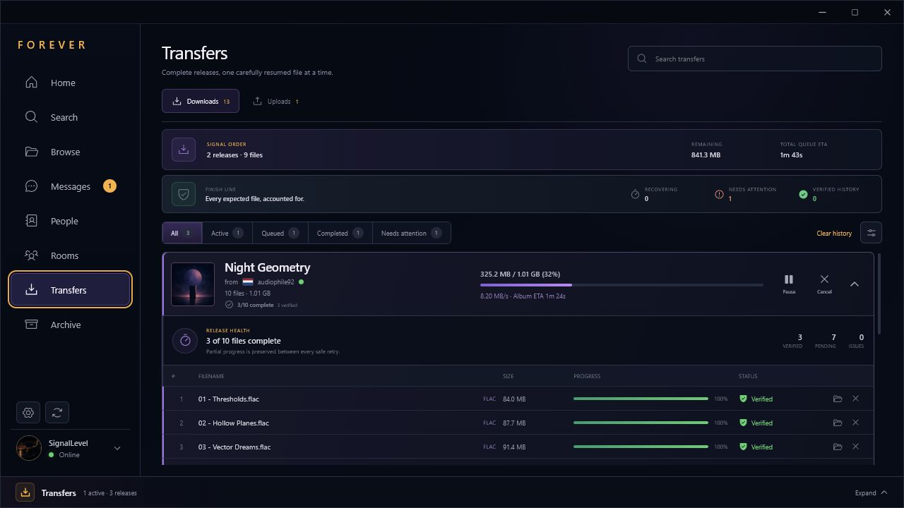
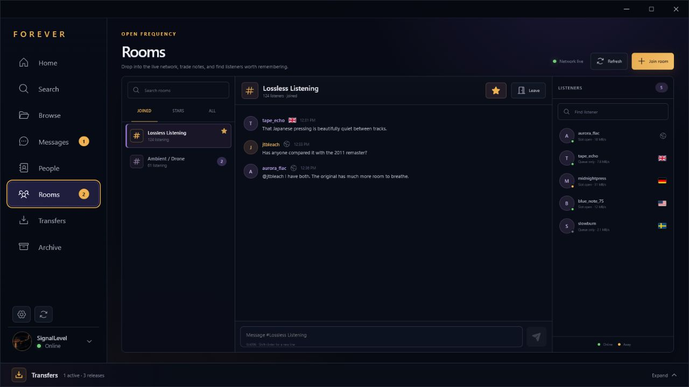
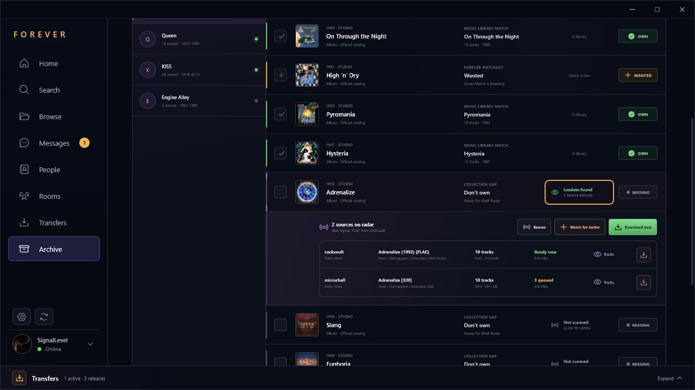
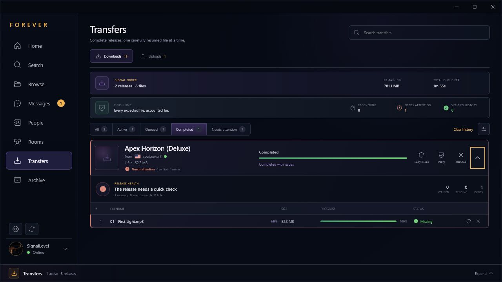

# Forever

Forever is a fast, polished desktop client for the Soulseek network, built with
Rust, Tauri 2, React, and TypeScript.

> **Status:** pre-alpha. Version `0.0.69` separates the connection service into
> focused modules, makes download scheduling event-driven, and adds parser fuzzing.

If `0.0.16` is installed, download and run the latest `0.0.69` Windows installer
manually; the startup regression prevents `0.0.16` from opening its in-app
updater. Installing the hotfix over the existing copy preserves Forever's
configuration and transfers.









## Current foundation

- Faithful Midnight Radio desktop interface
- **The Listening Post** Home command center opens after startup with live
  active-transfer progress, queued releases, Wanted matches, unread messages,
  room mentions, recent transfer and Archive activity, and collection status;
  every signal links to its exact working destination
- First-run Soulseek account setup with native download-folder selection and
  a clear explanation of automatic username registration
- Live TCP login to the Soulseek server with explicit connecting,
  authenticating, online, reconnecting, offline, and error states
- Automatic reconnect with bounded exponential backoff and optional connection
  on startup
- Live Soulseek search with direct and indirect peer-response handling,
  streamed and deduplicated results, a 15-second response window, and bounded
  protocol parsing
- **Dial Memory** keeps up to eight Files and Albums searches open independently,
  routes live responses to the correct background preset, highlights unseen
  results, and preserves each search's filters, sort, layout, selection, and
  scroll position while switching
- Search presets can be duplicated, stopped, closed, reopened, or pinned across
  restarts. Pinned presets persist only their query and view settings—never
  stale network results—and support **Ctrl+T**, **Ctrl+W**, **Ctrl+Tab**, and
  **Ctrl+Shift+Tab**
- Virtualized file lists, file grids, and album-source lists keep large searches
  responsive, with measured expandable Tracklist Confidence rows, keyboard
  Arrow/Home/End navigation, and scroll restoration per preset and view
- Search filters for audio type, minimum bitrate (kbps), sample rate (Hz), bit
  depth, free upload slots, maximum queue length, size range (decimal MB),
  extensions, excluded path words, country, and blocked/ignored users;
  a per-user cap applies after sorting, counting whole sources in album view
- Click search column headers to reverse sorting, or use the sort menu for
  best match, readiness, speed, size, name, user, quality, track count, or format.
  Advanced filters and sort follow preset switching, duplication, and pinned
  preset restoration across restarts; older presets start with no advanced filters
- Lists in text filters accept commas or spaces. Country accepts two-letter
  codes (for example `NO, GB`) or `unknown`, using currently known People data.
  Excluded words match case-insensitive substrings anywhere in a file path.
  Missing metadata fails active numeric filters; an empty field imposes no limit.
  The **24-bit / 96 kHz** shortcut sets both minimums; it does not verify audio quality
- Album filters keep sources intact: every returned audio track must pass quality
  and extension filters, size applies to the aggregate source, and artwork and
  other companion files remain included. Filtered search metadata cannot guarantee
  what a later full-folder inspection will return. The normal reviewed download
  and Tracklist Confidence flow still applies
- Stop control and a live file inspector with source speed, queue, and share visibility
- A Files/Albums search switch with MusicBrainz artist matching, artist
  disambiguation, studio/live/compilation/EP catalog filters, Cover Art Archive
  artwork, and one-click artist-plus-album handoff to grouped Soulseek sources
- Shared album-query normalization and paced empty-result fallbacks for Wanted,
  Shelf Radar, Signal Relay, and album handoffs, with successful variants
  remembered across restarts
- Album-source results grouped by listener and remote folder, with track count,
  formats, aggregate search size, readiness and speed, hover/focus track-list
  previews, an individual-file fallback, complete-folder download, and live
  **Downloading** or numbered **Queued #1**, **Queued #2** actions that stay
  synchronized as releases are reordered, paused, completed, failed, or removed;
  Wanted comparisons hide folders below that album's track minimum and compute
  their file, source, and listener totals from qualifying folders only;
  **Tracklist Confidence** compares normalized filenames with official
  MusicBrainz titles and durations, with saved edition selection and matched,
  missing, unexpected-track, and per-track length evidence
- A dedicated Archive workspace that opens Music Library's
  `music-library.sqlite3` database with SQLite read-only and query-only
  enforcement, reports its latest import and inventory totals, and never adds
  Forever downloads to the external collection
- **Arrival Desk** inside Archive separates completed album downloads into
  **Ready to file**, **Filed away**, **Moved**, and **Needs attention** lanes,
  with manual filing confirmation, undo, reveal, verification, per-release
  history removal, and a bulk clear for filed history that never deletes files
- **Soundcheck** automatically performs a quick, read-only inspection of newly
  completed audio and persists codec, container, duration, bitrate, sample rate,
  bit depth, channel count, track number, and any review notes per file
- Expandable Arrival Desk evidence summarizes **Passed**, **Review**, **Failed**,
  and pending releases, checks album audio count and numbering against the
  expected source track count, and offers a full decoder-based **Deep Scan**
- Quick inspection supports MP3, FLAC, AAC/M4A, OGG/Vorbis, WAV, AIFF, ALAC,
  and CAF; Opus receives safe header inspection where available, while other
  recognized formats remain visible as unsupported instead of being hidden
- Automatic Soundcheck is enabled by default and configurable in Settings.
  A failed release can open **Patch Bay**, which searches for per-track
  replacements, ranks them by identity and audio compatibility, and keeps
  verified tracks untouched.
- Patch Bay keeps selected repairs visible through queued, downloading,
  deep-checking, repaired, and needs-attention states; the plan persists across
  restarts, and the rejected original is preserved beside the album
- Format, duration, sample-rate, and bit-depth differences are shown before a
  replacement begins. Risky changes require explicit approval rather than
  silently creating a mixed release
- Album downloads retain their MusicBrainz release identity when available, so
  the earliest official tracklist can name a missing sequence position without
  making Music Library writable
- Completed downloads are reconciled with the read-only Music Library when
  their state changes and every five minutes while Forever is open, so albums
  move to **Filed away** after the external collection recognizes them
- A selective **Missing Shelf** that searches artists already present in Music
  Library, prefers its verified MusicBrainz artist links and cached official
  release groups, compares only the artist you open, and shows studio-album
  completion plus **Own**, **Wanted**, and **Missing** states
- Studio, Live, Compilation, EP, and decade filters, selection of visible
  collection gaps, and an atomic bulk handoff of up to 100 missing releases to
  Wanted using one shared Smart Match profile without duplicate watches;
  track matching can accept any count, use a custom minimum, or resolve each
  album's official MusicBrainz count, with a visible, persistent fallback count
  configured in Settings when that metadata is unavailable
- **Shelf Radar** scans one missing album, up to 12 selected albums, or up to 12
  visible gaps without replacing the main Search workspace; scans are explicit,
  sequential, cancellable, and held only for the current app session
- Live Shelf Radar states for queued, scanning, no sources, sources found, and
  lossless found, plus expandable grouped folders with listener, format, track
  count, size, upload slot, speed, queue, and track-list details
- Direct **Download best**, per-source download, rescan, and **Watch for better**
  actions inside Missing Shelf, with live transfer-state icons and queue position
  feedback after an album is handed off
- Shared **Signal Breadcrumbs** across Album Search, Missing Shelf, Wanted, and
  Browse Shares show numbered queue position, live percentage, pause,
  completion, and failure from the persisted transfer snapshot; selecting one
  opens and highlights the exact release in Transfers
- Batched **Owned** and **Don't own** markers across MusicBrainz discographies
  and Soulseek album-source reports, matched by saved release-group MBID links
  first, then normalized artist/title, with the match reason visible
- A separate **Wanted Signals** watchlist for albums that are still missing,
  with preferred 15-minute, 30-minute, hourly, or manual rhythms, server-paced
  wishlist checks, adaptive backoff, effective cadence estimates, and per-album
  pause/check/remove controls, in-app and Windows availability alerts, and
  configurable **Smart Match** profiles for format, minimum bitrate, and track
  count, including MP3-only matching and a reusable default for new watches
- Matching album downloads automatically leave active Wanted monitoring after
  every expected audio track verifies and Soundcheck passes when enabled,
  preventing redundant Smart Match checks and notifications; incomplete
  releases remain watched
- The **Fulfilled Shelf** keeps a compact completion receipt with the actual
  listener, format, audio-track count, size, Soundcheck result, completion time,
  and current Arrival Desk journey. Open the Arrival, reveal its folder, remove
  the receipt, or use **Add back** to begin a genuinely fresh watch
- Ranked Smart Match recommendations based on completeness, format, upload-slot
  readiness, speed, and queue length, with a remote-folder review that preserves
  artwork, cue sheets, lyrics, logs, and other companion files when explicitly
  queueing the complete album
- Automatic **Fulfilled** Wanted state when the external read-only Archive
  reports an owned album, without importing Forever downloads or modifying the
  Music Library database
- A dedicated top-level Browse workspace with exact-username entry and recent
  or favorite listener shortcuts, keeping full share trees separate from Search
- A dedicated People workspace with live online/away/offline presence,
  country flags, profile descriptions and images, interests, share/upload
  statistics, persistent favorites, ignored and banned listeners, and recent
  sources
- Profile entry points and country flags in Search, User Shares, Transfers,
  uploads, and the transfer shelf
- A dedicated two-pane Midnight Inbox for native Soulseek private messages,
  with persistent per-user history, unread and presence indicators, full-history
  search, exact-username starts, drafts, and an online-aware composer
- Queued, sent, and failed outgoing-message states with retry, plus mark
  read/unread, clear-history, and remove-conversation controls
- Configurable native Windows notifications for incoming private messages
- A dedicated three-pane **Open Frequency** workspace for native Soulseek
  public rooms, with room search, Joined/Stars/All filters, join/leave,
  auto-rejoin, unread and mention badges, and a live room composer
- A room listener rail with presence, country, upload-slot availability,
  reported speed and share totals, plus Profile, Message, Browse, Save, Ignore,
  and Ban actions
- Bounded local room history and configurable native Windows notifications for
  mentions and new messages in starred rooms
- Separate Ignore User filtering for messages/search activity and Ban User
  protection for local share browsing, queues, and downloads
- Real single-file downloads from live results using direct and indirect peer
  connections, with one active file per source user and one to six concurrent
  users (three by default)
- Live source-folder inspection using Soulseek Folder Contents requests, with
  complete subfolder results, file sizes, formats, and available audio quality
  attributes
- Complete user-share browsing using Soulseek's compressed Shared File List
  exchange, including public/private folder metadata, bounded parsing, a
  session-only cache, local filename/path search, format filters, and sorting
- A three-pane User Shares Explorer with folder navigation, detailed file
  metadata, folder-name and file search, expandable/collapsible hierarchy,
  multi-folder selection, selected-byte totals, and direct handoff to the
  grouped transfer queue
- A polished release selector with per-file choices, Select all/Deselect all,
  selected-file counts, and aggregate download size
- Whole-release enqueue into a collision-free local release folder, with
  MusicBrainz-guided `Artist - Album (Year)` naming plus persisted file order
  and resume state across restarts
- Persistent transfers with source-queue position and waiting age, byte
  progress, speed, ETA, pause, resume, retry, cancel, completion, and Show in
  folder controls
- Bounded automatic recovery for transient peer interruptions with visible
  retry attempts and countdowns while preserving safe `.part` progress
- **Finish Line** release health with expected-file verification, Moved,
  Missing, and Size mismatch states, a Needs attention filter, verification
  timestamps, automatic rechecks when Transfers opens and before Reveal,
  manual recheck/retry actions, and persistent completion history that never
  deletes downloaded files
- Archive-aware filing recognizes a completed, owned album when all downloaded
  audio has moved into Music Library but lyrics, artwork, or metadata remain in
  Forever's folder, avoiding a false partial-loss warning
- **Signal Relay** source rescue for stalled album queues, with a configurable
  suggestion delay, fresh background Soulseek scans, ranked same-format routes,
  and an in-place approval drawer instead of an automatic source change
- Safe source handoff preserves completed files and partial progress only for
  exact basename-and-size mirrors; compatible replacement files restart from
  zero rather than risking corrupt output
- A full release-grouped Transfers workspace with All, Active, Queued,
  Completed, and Needs attention filters, transfer search, aggregate and
  per-file progress, whole-album ETA, release-level controls, Clear history,
  and in-app plus native completion notifications
- Clickable queue/start/failure/completion notifications and transfer-shelf
  release titles provide a direct route to the expanded release without
  interrupting discovery when a download is first queued
- A persistent **Signal Order** for queued albums with drag-and-drop,
  keyboard-friendly Move up/Move down controls, **Download next**, exact
  duplicate-source protection, and a queue-wide release/file/size/ETA summary,
  plus a collapsed-by-default bottom drawer for quick status without sacrificing
  workspace height
- Persistent local shared-folder configuration with native selection,
  enable/disable, removal, rescanning, virtual aliases, and indexed totals
- Cached audio headers publish duration, estimated average bitrate, sample rate,
  and bit depth in search, browse, and folder responses. Debounced folder watching
  updates changed subtrees; Settings shows watcher health and cache reuse.
- Bounded background indexing for complete release folders—including audio,
  artwork, lyrics, cue sheets, logs, booklets, checksums, playlists, archives,
  and extensionless files—while excluding hidden entries, symbolic links,
  zero-byte or partial/temporary files, and unsafe root overlaps
- Live Soulseek browse and folder responses for local shares without exposing
  absolute filesystem paths
- Leaf and bounded branch participation in Soulseek's distributed search network,
  including parent discovery, branch-root delivery, child relaying, reconnect
  recovery, and real search responses from the local share index
- Indexed global-search matching with required words, `-excluded` words, and
  `*partial` terms, plus bounded deduplication and request-rate controls
- Server-provided excluded phrases (code 160) filter full virtual file paths,
  case-insensitively, in server/distributed search results, browse lists, and
  folder responses. Queued search replies are checked again before sending.
  Lists replace the previous in-memory set; an empty list clears it. Invalid
  updates retain the last valid list, also retained across reconnects until
  replaced. Local files and the share index remain unchanged.
- Live global-search relay state, branch discovery, request counters, and safe
  connection diagnostics in Settings
- Real resumable uploads with queue positions, one to three configurable slots,
  progress, speed, ETA, cancellation, failure states, and an Uploads workspace
- Completed uploads report average bytes per second to the server (code 121),
  measured from newly sent bytes through the downloader's closing confirmation.
  Resumed bytes are excluded; cancelled, failed, and zero-byte attempts send no
  speed sample. Missing confirmation fails after 30 seconds. Reports stay with
  their originating server session and are never replayed after reconnecting.
- Safe `.part` files, resumable offsets, exact-size checks, sanitized local
  names, collision-free destinations, and no overwrite of existing files
- Passwords stored in Windows Credential Manager, or held only in memory when
  “Remember password” is disabled
- Non-secret JSON connection preferences, bounded daily diagnostic logs, local
  panic reports, and **Export diagnostics** in Settings for private bug-report ZIPs
- Local design-preview data when the React frontend runs outside Tauri
- Custom frameless Windows shell and branded application icons
- In-app update checks at startup and every five minutes by default, with a
  persistent cadence setting, toast, release modal, progress, verification,
  changelog-backed release highlights, and restart flow
- Native Windows taskbar update badge that stays visible while a release is
  available and clears when downloading begins or Forever is current
- **Safe Passage** update choices can pause and flush active `.part` files
  immediately or drain current file writers without advancing the queue;
  unfinished work resumes automatically after the verified update restarts
- Native close protection intercepts the title-bar close button, Alt+F4, and
  taskbar close while downloads are writing, offering **Pause safely & exit**
  or **Keep running** instead of abandoning active file handles
- GitHub CI for linting, typechecking, frontend tests, Rust formatting, Clippy,
  and Rust tests
- Automatic GitHub Releases containing NSIS `.exe` and WiX `.msi` installers
- Signed Tauri updater artifacts, `latest.json`, and SHA-256 checksums

## Direct connections and global-search branches

Settings → **Direct connections** saves a TCP listening port (default **2234**).
On conflict, Forever tries the next six ports without wrapping past 65535, then
an OS-assigned port. Settings shows both the actual **listening** port and the
**advertised** external port; saving preserves your preference and disconnects
so you can reconnect with the new settings.

**Automatic router mapping** is enabled by default. Forever tries UPnP IGD,
then PCP and NAT-PMP on the network interface used by the server connection.
It requests a 30-minute TCP lease, renews at half the granted lifetime, and
announces the external port returned by the router. Failed discovery retries
after five minutes; manual forwarding and indirect connections remain usable.
Mappings are removed on disconnect, account changes, normal exit, and before
an update installer runs. Creation and cleanup are serialized across sessions;
cleanup failures are logged. Forced termination, lost router replies, or an
unreachable router can leave a mapping until its lease expires. Routers that
only support permanent UPnP mappings are deliberately left for manual setup.

**Test direct connections** asks [Soulseek's official port checker](http://tools.slsknet.org/porttest.php)
to connect to the advertised port. The service currently uses HTTP; only the
port number is submitted, and the checker sees the request's public IP. No
username, password, filenames, or account data is sent. The request is bound
to the server connection's local interface and bypasses HTTP proxies.

- **Reachable** requires an observed incoming TCP connection from outside local,
  loopback, and carrier-grade NAT address ranges. An “OPEN” web response or a
  successful router mapping alone cannot establish this state.
- **Firewalled** means the checker explicitly reported the requested port closed
  and no outside connection arrived during that test.
- **Unknown** covers no evidence, expired evidence (30 minutes), and unavailable
  or unrecognized checker responses. A later incoming connection updates the
  result. Tests are limited to one at a time and at least ten seconds apart.

For manual forwarding, forward the actual listening TCP port to this PC and
allow Forever through Windows Firewall. Double NAT, CGNAT, and VPNs can require
additional configuration; automatic mapping cannot guarantee reachability.

**Help relay global searches** is enabled by default. Forever accepts up to four
children only after confirmed reachability, 60 seconds with an established
upstream topology, and the server's minimum upload speed and child-ratio rules.
New accounts without a reported upload speed remain leaves. Settings shows
child capacity, active children, and relayed-search totals. Only searches from
the selected parent or server are relayed; duplicate/rate guards, bounded child
queues, and write deadlines prevent slow peers from blocking other work.
Parent loss, server reset, lost reachability, or disconnect clears children.

Protocol references: [Soulseek distributed messages](https://nicotine-plus.org/doc/SLSKPROTOCOL.html),
[igd-next](https://docs.rs/igd-next/0.17.1/igd_next/), and
[crab_nat](https://docs.rs/crab_nat/0.8.1/crab_nat/).
Regression checks use local sockets and simulated lease lifecycles; router
compatibility, Windows Firewall prompts, and public Soulseek interoperation
still require testing on the user's actual network.

## Requirements

- Node.js 22
- Rust stable
- Windows development prerequisites from the
  [Tauri documentation](https://v2.tauri.app/start/prerequisites/)

## Development

The connection backend uses registered hub handlers and shared session lifecycle
hooks. Downloads wake on queue changes and retry deadlines. See
[connection architecture](docs/connection-architecture.md) for module ownership,
timer behavior, and regression coverage, and [protocol fuzzing](src-tauri/fuzz/README.md)
for the standalone parser targets and local/CI commands.

```powershell
npm install
npm run tauri dev
```

The browser preview can run without the desktop shell:

```powershell
npm run dev
```

Smart Match in the local browser preview and frontend integration tests uses the
same Rust matching crate as the desktop app. Rust/Cargo must be installed; the
first matching request builds a small helper under `src-tauri/target/matching`.
The local Vite server runs that helper only for matching calculations. Preview
network activity remains simulated. Restart Vite after editing Rust matching
code; `cargo clean` removes this helper too. Run `cargo test --workspace
--all-targets --all-features` from `src-tauri` to include the matching crate's
unit tests alongside the desktop tests.

Use `http://localhost:1420/?update=available` during frontend development to
preview the update toast and modal without publishing a release.

Use `http://localhost:1420/?onboarding=1` to preview the fresh-install
connection flow. The browser preview simulates connection state; run
`npm run tauri dev` to exercise the native credential vault and live Soulseek
login, network search, folder browsing, downloads, and uploads. Search for an artist,
album, track, or filename while connected; results stream into the table as
peers respond. Each search listens for responses for 15 seconds and can be
stopped early. Open up to eight independent searches from the preset rail;
background results stay with their originating preset and show a new-result
count until opened. Select a live file and choose **Browse folder** to request its
complete source folder. Choose the files you want, then select **Download**;
Forever creates a safe release folder beneath the download location configured
in Connection settings and adds the files in their displayed order. Choose the
folder icon on any result—or **Browse shares** in the source inspector—to open
that listener's complete shares. Source names in the transfer shelf and full
Transfers workspace open the listener's People profile, where complete shares
remain one action away. Expand or collapse branches in the
folder rail. Share-list search returns matching folders and files locally after
the list is received; choose a folder result to open it directly. **Refresh**
explicitly asks the peer again.

Switch Search from **Files** to **Albums** to enter an artist name. Forever
uses MusicBrainz to resolve the artist and show cataloged studio albums, live
albums, compilations, and EPs. Choosing **Search Soulseek** returns to Files and
starts an album-aware Soulseek search for that artist and album title. MusicBrainz
identifies the release; it does not claim that a specific rip or edition is
available. Soulseek results remain the source of truth for actual files. The
search opens in **Album sources**, grouping returned files by listener and
folder. Hover or focus the eye control to preview that source's tracks; switch
to **Individual files** for the original file-by-file results. When an official
tracklist is available, each album source reports its title match as **Exact**,
**Complete with extras**, **Missing**, **Duration mismatch**, or **Unclear**.
Expand that signal to see matched filenames, missing official titles,
unexpected audio files, and length differences.

Album searches share one Rust query builder across handoffs, Wanted, Shelf
Radar, and Signal Relay. It folds accents and punctuation, treats `&` and `and`
consistently, removes recognized trailing edition/remaster labels, drops short
words when longer words remain, and caps queries at 200 bytes on word boundaries.
Entirely short names such as U2 and AC/DC remain searchable. Meaningful title
text and volume numbers remain distinct in the saved identity.

After an attempt returns no accepted audio files, Forever tries the album title
alone, then the artist with up to two distinctive title words. Duplicate queries
are skipped, with at most three attempts. Broader attempts require the artist's
normalized words in each returned path; paths that omit the artist can therefore
be missed. Search, Wanted, and Radar status show the current query. Successful
variants are reused first and saved in `search-queries.json` for up to 1,000 album
identities. This is a query preference, not proof of an edition or complete album.

Each attempt waits for the shared search budget before its response window starts
(15 seconds, or 12 seconds for Radar). Automatic Wanted fallbacks also wait for
the server's wishlist interval: an empty album can consume up to three server
slots, so a complete empty sweep can take up to three times the displayed
single-query capacity estimate, plus other delays. Stop, close, replacement, and
disconnect cancel pending attempts. Ordinary typed Files searches retain their
original query syntax. New album transfers preserve artist/title metadata for
Relay; legacy or manually browsed folders without that identity receive query
normalization only. Browser preview data does not simulate native fallback logic.

The default **Best match** sort puts complete title matches ahead of faster but
mislabeled folders.
Questionable sources remain available, but require an explicit **Download
anyway** confirmation. **Download
album** inspects the chosen folder and queues every file in it, including cover
art, lyrics, cue sheets, and other companion files. Search stays open so more
albums can be added: the active source turns green and reads **Downloading**,
while later sources turn blue and read **Queued**. When MusicBrainz supplied
the catalog context, the destination is named `Artist - Album (Year)`; without
that context Forever falls back to the shared folder name.

Open **Archive** to inspect the external Music Library source. On Windows,
Forever discovers it at
`%APPDATA%\com.local.musiclibrary\music-library.sqlite3`, reads the latest
completed import plus the normalized `albums` inventory, and uses that data to
mark cataloged releases as **Owned** or **Don't own**. **Refresh Archive** picks
up a newer Music Library import. Forever opens this database using SQLite's
read-only flag and query-only mode; it has no Archive write command. Soulseek
downloads continue to use the folder configured under Connection settings and
are never imported into Archive.

In **Archive → Library source**, **Choose database…** selects a different
Music Library SQLite database. Forever validates it read-only before saving;
invalid or cancelled choices leave the current source unchanged. **Use automatic
location** restores the default. The source shows **Detected automatically** when
connected at the default location, or **Custom database** for a selected file.
A missing custom file remains visibly unavailable rather than switching libraries.
The preference is saved in Forever's unified `settings.json` and survives restarts.
Changing source clears ownership results and Missing Shelf caches.

Ownership first checks saved `include` decisions in
`musicbrainz_release_decisions` that reference a surviving local album and a
verified, non-ignored artist link. These saved release-group MBIDs can match
changed artist/title spellings. Conflicting saved identities are excluded from
MBID matching; known different MBIDs do not fall through to a title match.
Where no saved identity is available, matching uses shared Unicode-aware artist
and title normalization, with original album year and stable local IDs breaking
ties. **Owned · MBID** and **Owned · Title** distinguish the evidence; hover for
local album details and the matched MBID. This confirms album ownership, not a
particular pressing. Cached release-group catalogs alone are never proof of ownership.

Open **Archive → Arrivals** after downloading an album. Forever shows verified
downloads as **Ready to file**, recognizes albums already present in Music
Library as **Filed away**, and distinguishes a complete move from a genuine
partial-file issue. Use **Mark as filed** when you have moved an album into a
different collection that Music Library does not track; the confirmation is
stored only in Forever and can be undone. **Clear filed history** and the row
trash controls remove completed transfer records only—they never delete music
or write to Music Library. Use **Reconcile now** for an immediate read-only
check; otherwise Forever rechecks automatically every five minutes.

Open **Archive → Missing shelf** to browse or search artists found in Music
Library. Forever initially shows a bounded list and does not scan every artist's
catalog in the background. Selecting one artist first uses Music Library's
verified MusicBrainz link and cached official release groups when available;
only that selected shelf can trigger a live MusicBrainz fallback. If the local
artist is not linked, choose the correct MusicBrainz identity for the current
session—Forever does not write that choice back to Music Library. Completed
artist comparisons are reused for the current app session and cleared by
**Refresh Archive**.

The shelf reports studio-album completion and labels each release **Own**,
**Wanted**, or **Missing**. Filter the catalog by Studio, Live, Compilation, EP,
or decade, select one or more visible gaps, and choose a shared Smart Match
format and bitrate. **Tracks** can accept **Any** count, use one **Custom**
minimum for the batch, or read the earliest official edition from
**MusicBrainz** and assign its count separately to each selected album. Then use
**Add to Wanted**. The bulk action deduplicates existing watches and writes once
to Forever's separate `wanted.json`; the Music Library database remains
untouched. If an album has no official tracklist or the lookup is unavailable,
Forever still adds it using the dedicated **MusicBrainz fallback tracks** value
from Settings (10 tracks until you change it) and identifies the fallback in
the completed bar.

Use **Scan visible** to check up to the first 12 visible missing albums, or
select specific gaps and use **Scan selected**. Shelf Radar sends one search at
a time, listens for 12 seconds per attempt, and pauses briefly between albums. Its progress
strip shows the current album and can stop the remaining queue immediately.
Scanning never replaces or clears the main Search workspace.

Completed scans stay in memory for the current app session. A release reports
whether no sources answered, grouped sources were found, or a lossless folder
is available. Open the signal to compare up to five responding folders and
preview their audio tracks. **Download best** inspects the recommended remote
folder before queueing the complete release, then both the recommended button
and its exact source-row icon follow the live Preparing, Downloading, Queued,
Paused, Downloaded, or Needs attention state. **Watch for better** creates
an ordinary Wanted entry using the selected Smart Match profile. Non-audio-only
folders are excluded from album-source availability. Neither action writes to
Music Library; downloads and watches remain in Forever's own stores.



Open **Transfers** to see Finish Line health for every queued or completed
release. Transient peer disconnects retry after short bounded delays and show
their next attempt in place; pausing or cancelling still takes precedence.
When a release finishes, Forever checks that every expected local filename is
present at the expected byte size and sends an in-app and Windows completion
notification. Soulseek does not provide content hashes, so this is a structural
completion check rather than cryptographic audio verification.

Forever automatically rechecks every completed release when **Transfers** opens
and rechecks the selected release immediately before **Reveal** opens its folder.
Each health card states when its oldest file check ran; **Verify** remains
available for an immediate manual refresh. When an entire completed release
leaves Forever's download folder together, Finish Line classifies it as
**Moved** and keeps it in safe history. If Music Library owns the album and all
downloaded audio has left while lyrics, artwork, or metadata remain, it is
classified as **Filed away** instead of damaged. **Download again** can restore
another copy if needed. Unexplained partial file loss still uses **Needs
attention** and can be safely requeued with **Retry issues**. A size mismatch is
reported but is never overwritten automatically. Album queues created from grouped
Search or Shelf Radar results retain compatible alternative listeners; expand
the release, open **Alternative signals**, and choose **Try source** to switch
only exact basename-and-size matches while already verified files remain
complete. **Clear history** removes completed transfer records only—the files
in the download folder remain untouched.



Choose **Add to Wanted** on a missing MusicBrainz album, then open **Archive →
Wanted** to follow it. Automatic checks use Soulseek **WishlistSearch (103)**
only after **WishlistInterval (104)** announces a positive interval in seconds.
One query is sent per server interval; a zero interval disables automatic
checks, and reconnecting waits for a fresh announcement. Forever never falls
back to ordinary searches to bypass this limit. The first automatic check waits
one announced interval; a changed interval is applied to the last wishlist send.
These wire contracts follow the [Nicotine+ protocol documentation](https://nicotine-plus.org/doc/SLSKPROTOCOL.html#server-code-103).

**Preferred rhythm** is a target for each album, not a promise. New and recently
found albums use that target; consecutive completed checks without audio sources
back off to **1 hour -> 6 hours -> 24 hours**. Finding sources resets the backoff.
Failures and disconnects do not count as empty checks. Backoff survives restarts;
legacy stores migrate without inventing missing search history. Paused and
fulfilled albums consume no slots. Overdue albums are served by due time, with
stable ordering so a large list rotates fairly.

The Wanted toolbar shows estimated capacity at the current active list size,
plus the earliest next slot. With 500 active albums and a 12-minute server
interval, a rotation with one attempt per album takes roughly **100 hours**.
Empty-result fallbacks can require up to three attempts per album. Quiet-watch
backoff and competing searches can extend the interval; this is an estimate,
not a deadline. Manual **Check now** remains available even when automatic
checks are disabled, and shows when it is waiting to send.

All outgoing search producers share a minimum **five-second gap**, with priority
**user (including manual Wanted) -> Signal Relay -> Shelf Radar -> automatic Wanted**.
This is Forever's conservative local policy, not a published ordinary-search
server limit. Existing bounded producer queues retain work while waiting; stopped,
closed, replaced, paused, or fulfilled queued checks are discarded. Response
windows start on dispatch, so waiting does not consume search time. Reconnects
clear queued work and require new server wishlist permission; missed slots never
cause a catch-up burst. Sustained higher-priority traffic can delay background
checks. Public-server interoperation has not been verified live.

Forever groups returned audio by listener and remote folder without disturbing
the visible Search workspace. Edit a row's **Smart Match profile** to prefer
lossless, require lossless, require MP3, or accept any format, then optionally
set minimum bitrate and track-count requirements. Forever suggests the track
count from the chosen official MusicBrainz edition when available. Select
**Use this as my default profile** to apply the same starting profile to future
Wanted albums. Qualifying folders are ranked by completeness, format, free
upload slot, speed, and queue length. One Rust matcher supplies rankings and
Tracklist Confidence to Wanted, Search, Radar's source drawer, and folder review.
Background Wanted checks load the same official MusicBrainz title list as review;
metadata has a 45-second deadline. Automatic edition lookup failure uses a visible
**Track count only** fallback; a saved edition must load before it is recommended.
Different available files or metadata can still change a later review.
Unknown or zero bitrates in lossy-only folders cannot satisfy a configured minimum.
Equal scores first compare the proportion of official tracks with agreeing lengths,
then use stable listener/folder ties, independent of reply order.

Archive ownership, album queries, and track matching share NFKD accent folding,
punctuation spacing, and `&` → `and` normalization (including Björk/Bjork).
Track filenames additionally lose audio extensions, track/disc prefixes, and
conservative remaster suffixes. Official titles retain meaningful dotted words.
The TypeScript layer contains no scoring or title-matching implementation.
Shared golden fixtures cover Rust and the real frontend-to-Rust bridge; stale
asynchronous replies cannot restore an older recommendation.

Choose **MusicBrainz edition** in the review dialog or the album's Smart Match
profile, including when no source is currently recommended. The release list
shows dates, regions, edition descriptions, media formats, track counts, and a
short release ID to distinguish otherwise identical entries. **Automatic** uses
the earliest official edition with the common original-year track count.
The list is cached for seven days across restarts, bounded to 500 releases, and explicitly marked
when incomplete. Selection validates official status and release-group membership,
is saved per Wanted album in schema 4, clears old recommendations, and applies to
background checks and foreground comparisons. Existing Wanted albums migrate to
Automatic. Edition selection saves immediately; format/bitrate profile defaults
remain separate.

For each title match, lengths within **±3 seconds** agree. Larger differences
flag a **Duration mismatch** and prevent a Smart Match recommendation; missing
or zero lengths are **unknown**, retain title-based eligibility, and never count
as duration agreement. Review expands per-track differences before queueing.
Reported metadata can flag live versions or truncated files, but cannot prove
audio integrity or identify a pressing/remaster with the same titles and lengths.

Sibling folders named exactly **CD1**, **Disc 2**, **disk-03**, etc. are grouped
under their album parent for the same listener. Other named edition folders stay
separate. Inspection requests every advertised disc, deduplicates files also
returned with the parent, keeps parent companions, and fails if a disc cannot
be verified. Downloads preserve numbered disc subdirectories under one release,
including repeated filenames. Only advertised discs can be inspected: a search
that never returns a missing disc cannot establish completeness without an
official tracklist.

Use **Download best** to inspect the recommended folder before anything is
queued. The review shows the listener, remote path, format, tracks, aggregate
size, source speed, the audio/companion-file split, and Tracklist Confidence.
An exact title match with no known length mismatch outranks format and speed;
a missing, mismatched, or unclear tracklist
cannot be queued as the recommended source and sends you to **Compare** instead.
When MusicBrainz has no official title list, Forever keeps using the existing
track-count and Smart Match profile rules. **Queue complete album**
preserves cover art, cue sheets, lyrics, logs, and other files beside the audio
and leaves Archive open so another album can be queued. After every expected
audio track completes and verifies, Forever moves that album out of active
monitoring and into the **Fulfilled Shelf**, stopping its Smart Match alerts. A
failed or incomplete release stays watched. The saved receipt records the
actual source, format, track count, size, Soundcheck result, and completion time.
Use **Add back** to start a fresh watch—even when Music Library already owns the
album—and only a newer verification can fulfill it again. **Compare** opens the
grouped source report with the recommendation highlighted and hides partial
folders below that album's minimum track count. Its totals describe only the
qualifying folders; switch to **Individual files** to inspect every raw Soulseek
reply. Forever never auto-downloads a Smart Match. When
the read-only Music Library Archive reports another watched album as owned, its
watch moves to **Fulfilled** and stops checking; it returns to the active list
if the external source no longer reports it.

Open **Browse** for a dedicated exact-username entry point plus recent and
favorite listeners. Browsing from Search, People, or Transfers opens the same
workspace, and **Browse another** returns to its listener picker.

Open **People** to revisit recent sources and favorites, see their live
presence and country, inspect profile notes and interests, or browse everything
they share. Listener names in Search and Transfers open the same profile. The
**Message** action opens that listener in the dedicated **Messages** workspace.
Search conversations and message text, start a thread with an exact username,
keep drafts while navigating, and retry an interrupted outgoing message. Each
thread can be marked read or unread, cleared, or removed. **Ignore User** hides
that listener's new private messages and search activity on this device. **Ban
User** prevents that listener from browsing, queuing, or downloading your
shares until the ban is removed.

Open **Rooms** to load Soulseek's public room directory. Filter the dial to
rooms already joined, starred rooms, or the complete public list; search by
room name; then join from the directory or enter an exact public room name.
Rooms selected for joining automatically reconnect with the next Soulseek
session. Leaving a room disables that auto-rejoin preference.

Joined rooms show live chat, unread and mention markers, and a searchable
listener rail. Select a listener to inspect their reported presence, country,
upload-slot availability, speed, shared files, and folders, or jump directly
to Profile, Message, and Browse shares. Save, Ignore, and Ban reuse the People
workspace's existing device-local preferences. Room history is bounded to the
most recent 250 messages in each of at most 64 remembered rooms. Private-room
administration is not part of v0.0.31.

Add releases under **Settings → Your shared releases**. Forever gives each
selected root a virtual alias, indexes every safe, non-empty regular file in the
background, and announces the resulting public counts to Soulseek. This keeps
cover artwork, lyrics, cue sheets, logs, booklets, checksums, playlists, and
other companion files beside the audio. Disable a root without forgetting it,
let folder watching update changed files, and choose one to three outgoing upload slots.
Incoming browse, folder, global-search, queue, and download requests are then
served from the safe in-memory index. Connection settings shows whether
Forever has joined the global-search relay and how many requests it has
received and answered. Follow outgoing activity under **Transfers → Uploads**.

Audio headers are read with Symphonia, without decoding or changing files. Known
duration, sample rate, and bit depth are included in outgoing Soulseek attributes.
Bitrate is an **estimated container average** (file bytes / duration), which can
include artwork/tags; it is not a nominal encoder setting. VBR remains unknown.
Unsupported, malformed, or oversized headers leave attributes unknown while the
file remains shareable. Header reads are capped at 8 MiB per changed file.

The local `share-index.sqlite3` cache stores paths, sizes, nanosecond modification
timestamps, and header results in a versioned SQLite WAL database. Startup and
**Rescan** walk enabled roots but reuse unchanged headers; watcher updates scan
only affected parent subtrees and rebuild the in-memory search maps in the
background. New, changed, moved, and removed files update all share responses and
server counts. Disabled/removed roots stop being advertised, including in queued
search replies. Hidden entries, symlinks, and Windows junctions remain excluded.

Watcher events settle for 750 ms, with a five-second maximum delay during bursts.
Bounded event overflow requests full reconciliation. A five-minute reconciliation
also covers missed events, unavailable/network drives, and watcher failures;
watch registration is retried every 30 seconds. Settings shows watcher/cache
errors and the last update's cached/inspected file counts. Manual **Rescan** remains
available. Cache failures preserve the cache and continue with uncached headers;
after closing Forever, a damaged cache can be moved aside to rebuild it. The cache
is disposable and never grants permission to share a root. Source-file edits that
preserve both size and modification time cannot be detected by this cache key.

**Settings → Your shared releases → Upload fairness** controls outgoing policy.
Users with fewer active uploads get the next free slot; users at the same level
take turns, with FIFO order within each user's files. A new waiting user gets a
first slot before an already active user gets another. Existing transfers are
never interrupted to rebalance slots. The global pending cap remains 500 files.

Per-user defaults are **100 files** and **10,000 MB** (decimal: 1 MB = 1,000,000
bytes). Limits include queued and active files at their full size; resume offsets
do not reduce the quota. Allowed settings are 1–500 files and 1–1,000,000 MB.
Repeated requests for the same pending file are idempotent. Excess requests receive
Soulseek's `Too many files` or `Too many megabytes` denial. Lowering a limit affects
new requests and preserves already accepted requests.

Both priority switches default off. Favorites can go first within each turn,
followed by server-reported privileged users when enabled. When both switches are
on, favorites take precedence. Priority does not give anyone a second turn before
other waiting users at the same active-slot level. Privilege data comes from server
code 69, stays in memory, and is cleared on disconnect.

Pending requests and turn history are saved in `uploads.json` using atomic
replacement, validated backups, and corruption notices. Queued order survives
restarts under the same policy; interrupted active uploads rejoin the queue and
renegotiate the downloader's resume offset. Live queue positions can change with
arrivals, completions, policy changes, and restored active requests. Startup waits
for indexing and validates the current share and block list before dispatch and
file send. Removed, disabled, missing, resized, or excluded files are not sent.
Finished upload history and session totals remain session-only. Save failures are
shown in Settings and Uploads; new admissions/starts require a successful save,
and failed saves are retried while connected. Progress updates do not write disk.

Downloads use one file at a time from each source user, while different users
can transfer in parallel. Set **Settings → Download lanes → Simultaneous users**
from one to six; the default is three. Transfers labels Forever's reorderable
**Local queue** separately from the source's already-submitted **Source queue**.
Set **Suggest another source after** to Off, 5, 10, 20, 30, or 60 minutes; the
default is 10 minutes. Once a release has waited that long, Signal Relay quietly
checks Soulseek for compatible album folders, shows a notification when routes
are ready, and leaves the final switch to you. The active transfer card can also
open Signal Relay or start a scan immediately.
Uploads default to one slot and can be raised to three. Edition/pressing lookup,
playback, and private-room administration remain outside this release.

Soulseek does not have a separate sign-up step. Connecting with a valid unused
username creates that account using the password you enter; only an existing
username can return a wrong-password error. Forever explains this in onboarding
and Connection settings rather than treating a successful registration as an
authentication failure.

Automatic update checks run every five minutes while Forever is open. Change
the cadence—or limit automatic checks to startup—in **Settings → Connection →
Automatic update checks**. Incoming private-message notifications can be
enabled or disabled in the same settings panel. Room alerts have a separate
toggle and notify only for direct mentions or new messages in starred rooms.

## Connection data and privacy

Download bytes, speed, and ETA stay in an active-transfer memory map. The UI
receives one small progress batch at most every 250 ms; full queue snapshots
are sent for lifecycle, metadata, and settings changes. A single background
writer coalesces pending saves to `transfers.json`, saving state transitions
and progress checkpoints every five seconds when progress changes. Resume
offsets still come from the actual `.part` file length. Closing Forever
(including an idle queue) and Safe Passage updates wait for pending saves;
save failures are shown and must be resolved before a safe exit can finish.
The core JSON stores (`transfers`, `uploads`, `wanted`, `search-queries`, `people`,
`messages`, `rooms`, `sharing`, and `connection`) now use a shared persistence layer. Saves write a
unique `name.json.tmp-*` in the same directory, flush its contents, atomically
replace the primary file, and retain the previous validated copy in
`name.json.bak`. Backup replacement is also atomic and happens before primary
replacement. Transfer saves retain the single background writer above.

On invalid JSON or invalid stored settings, Forever preserves the damaged bytes
in `name.json.corrupt-<timestamp>-<unique suffix>`, restores a valid backup when
available, or starts that store with empty/default data. A dismissible **Some
saved data needs attention** notice lists each affected store and preservation
path; recovery never deletes downloads or touches Music Library or credentials.
A restored backup may lack the most recent changes. Quarantine files are kept
for manual recovery and are not automatically deleted. Incomplete `.tmp-*`
files left by a killed process are ignored and can be removed while Forever is
closed.

Existing version-1 stores migrate to version 2, materializing legacy defaults;
unversioned connection preferences migrate to a version-1 profile envelope.
Further migrations bring connection settings to schema 2, sharing and transfers
to schema 3, and Wanted to schema 4. Existing transfers keep their labels and file state;
missing structured artist/title metadata is left unknown.
Migration validates the result and retains the original bytes as the backup.
Unknown store versions are preserved in place and cannot be overwritten by this
app version. Read/preservation/migration-write failures also keep the app open
with a notice and prevent saves to the affected store for that session. Resolve
the filesystem problem or use a compatible app version, then restart. Other
stores remain usable. Forgetting the connection account clears it from both the
unified settings file and its recovery copy, while preserving other preferences.
Legacy account files are never reimported after settings migration has completed.

This protects against interrupted writes; it is not a substitute for an external
backup. Power-loss durability depends on the filesystem and device honoring
flushes (Windows has no portable directory-fsync equivalent). Settings migration
from WebView storage is described below; message drafts remain in the WebView.

### Unified settings and moving to another PC

All preferences now live in one typed, versioned `settings.json` in Forever's
application configuration folder, using the same atomic saves, validated backup,
corruption recovery, and unsupported-version protection as the operational stores.
This includes connection and download location, download lanes, Signal Relay,
Soundcheck, shared folders and upload policy, Wanted scheduling and default matching,
Archive location, update cadence, notification toggles, MusicBrainz fallback count,
and Dial Memory's pinned presets and recent searches.

On the first launch, Forever imports settings from `connection.json`, `sharing.json`,
`archive.json`, and the preference fields in transfer and Wanted history. The old
settings files remain available for recovery but are no longer authoritative.
Transfer history and Wanted albums (including each album's matching preferences)
continue in their own stores; subsequent history saves omit the migrated preferences.
WebView preferences are imported once before the app starts using them. Their keys
are removed only after a successful save. A failed migration keeps the originals
and shows an error; fix the reported problem and restart. Invalid preset JSON stays
available in WebView storage for recovery. Draft messages, current open results,
selection, and scroll/layout state are not exported.

Open **Settings → Backup & restore settings** to export a `.json` file. Exports
include usernames, local folder paths, shared folders and search terms, so choose
where to keep them. Passwords, downloads, messages, transfer/upload history, and
Wanted albums are excluded. On another PC, import the file and review the account,
paths, shared folders and download defaults before selecting **Apply imported settings**.
The entire document is validated before saving; unsupported schemas, unknown fields,
invalid values and files over 256 KiB are rejected. No files or databases are moved.
Missing folders remain visible for correction, and enabled shared folders are indexed.

Preferences apply immediately. Account/network changes disconnect the current
session; connect again when ready and enter a password if this PC has none saved.
Imported pinned presets open on the next launch, preserving current searches and
navigation. **Reset section to defaults** previews its effect before confirmation.
Resetting sharing removes roots from Forever without deleting files; resetting
Wanted defaults retains albums and their individual profiles; resetting the account
also forgets its saved password. Browser preview changes are session-only.

### Diagnostics and bug reports

In **Settings → Recent activity → Export diagnostics**, choose where to save a ZIP.
It contains event codes, severity and timestamps from up to seven daily logs,
Forever/Tauri versions, OS/architecture, a settings summary of switches, numeric
limits and counts, and the latest Rust panic report when available. The manifest
reports omitted malformed records, unreadable files, truncation, and logging health.
Credentials, IP addresses, usernames, hostnames, local paths, search queries,
private messages, transfer history, and free-form log messages are excluded.
Nothing is uploaded automatically. Diagnostics export requires the desktop app.

New local logs use `logs/connection.YYYY-MM-DD.jsonl`, rotate at UTC midnight on
the next event, and retain at most seven files of up to 4 MiB each. After the daily
limit, the bounded recent-activity list keeps working and disk logging resumes
the next UTC day. Daily limits account for existing bytes after restart. Write
failures and the daily cap appear as recent-activity notices. Unavailable log
storage does not prevent startup; exports can still include recent events and
the settings summary, with missing files reported in the manifest. Older
`logs/connection.log` is preserved, no longer appended to, and excluded from ZIPs;
it may be removed manually when no longer needed.

The early panic hook saves `logs/crash-latest.json` atomically, retaining only the
latest Rust panic's timestamp, version, platform, and source filename/line/column.
Panic payloads, raw stacks, and absolute source paths are omitted. It runs before
Tauri startup and does not depend on the normal logging lock. Native crashes,
forced termination, and power loss are outside this hook's coverage. Exports are
written through a temporary file and cannot target Forever's configuration tree.

### Local data and connection safety

Forever writes non-secret account preferences to the Tauri application
configuration directory and connection events to
`logs/connection.YYYY-MM-DD.jsonl`. Release grouping, file order, and transfer
metadata are stored in `transfers.json` in the same configuration directory. Favorites,
ignored listeners, banned listeners, and recent source usernames are stored in
`people.json`. Bounded private-message history, unread state, and outgoing
delivery status are stored in `messages.json`. Bounded unsent drafts and the
message-notification preference are stored in the local WebView profile.
Room favorites, auto-rejoin choices, and bounded history are stored in
`rooms.json`; the room-notification preference is stored in the local WebView
profile. Live room member lists are session-only;
profile notes, profile images, interests, country, presence, and statistics
remain in memory for the current session. Shared-root
configuration, upload-slot count, and per-user upload policy are stored in
`sharing.json` (schema 3; earlier versions receive the defaults). Pending upload
requests, peer usernames, virtual filenames, sizes, and fairness turns are stored
in `uploads.json`; local file paths and connection tokens are excluded. The
sharing file contains local folder paths because Forever must reopen those roots,
but it never leaves the device. `share-index.sqlite3` beside it holds the derived
local index; optional `-wal` and `-shm` files are SQLite journals. Peer IP
addresses, temporary folder listings, cached user share lists, and credentials
are excluded. Share lists stay in memory only for the current app session.
Passwords are excluded from both. With “Remember
password” enabled, Windows Credential Manager stores the password; otherwise it
exists only for the current app session.

The MusicBrainz fallback track count is stored in the local WebView profile and
is used only when a Missing Shelf release has no official MusicBrainz track
data. The initial fallback is 10 tracks and can be changed in Settings.

Wanted albums, their configurable check rhythm, per-album Smart Match profiles,
last ranked source summary, fulfillment state, download completion receipts,
and source identity fingerprints are stored in Forever's `wanted.json`. A
receipt contains the release ID, Soulseek username, format, verified audio count,
download size, Soundcheck result, and completion time. These fingerprints
contain normalized Soulseek usernames and remote folder names so Forever can
recognize newly appearing qualifying sources; they never contain local Music
Library rows and are not written to the external Archive database. Successful
verified downloads remain only as quiet Fulfilled history until you remove or
re-add them; they never write to or import files into Music Library.

Archive reads the external Music Library database at
`%APPDATA%\com.local.musiclibrary\music-library.sqlite3` by default, or the
custom database selected in Library source. Forever uses the
`import_runs`, `albums`, and optional `musicbrainz_release_decisions` tables for
source status and ownership matching. For
Missing Shelf it also reads verified rows from `musicbrainz_artist_links` and
cached official rows from `musicbrainz_artist_release_groups`; absent tables or
links fall back safely without schema changes. The connection is opened with
`SQLITE_OPEN_READ_ONLY`, a two-second busy timeout, and `PRAGMA query_only = ON`;
Forever never migrates, creates, updates, or deletes anything in this database.
Album and track totals come from the latest completed import record rather than
a scan of the 1.8 GB source.

The legacy Soulseek protocol itself does not provide transport encryption.
Credential protection described above applies to local storage, not the
connection between the client and Soulseek server. Use a unique password that
you do not reuse for another service.

Album discovery sends the artist name over HTTPS to MusicBrainz and loads
available release artwork from the Cover Art Archive. Metadata is cached locally
in `%LOCALAPPDATA%\com.soundtrackgeek.forever\musicbrainz-cache.sqlite3` on Windows
(Tauri's application cache directory). Artist searches expire after one day;
catalogs and edition lists after seven days. Verified official tracklists are
keyed by release MBID, retain the album identity check, and have no time expiry.
This cache survives restarts and is separate from the read-only Music Library
Archive. Fresh cached lookups work offline and while live requests are throttled;
expired entries require an online refresh when requested.

The cache retains at most 4,096 entries and 64 MiB of JSON payloads, evicting the
oldest entries (including tracklists) when full; SQLite indexes, free pages, and
WAL files add disk overhead. Cache I/O runs off the async executor. Corrupt or
unsupported database files are preserved, disk failures use a session-only cache,
and a dismissible notice explains the fallback. To force fresh metadata or remove
saved artist searches, close Forever and delete `musicbrainz-cache.sqlite3` and
its `-wal`/`-shm` companions from that directory; the cache is rebuilt on demand.

All MusicBrainz callers share the build-version User-Agent and a governor that
spaces requests by at least 1.05 seconds. HTTP 429/503 gets at most two retries
after exponential backoff or a longer `Retry-After` delay (seconds or HTTP date).
A visible countdown explains the shared cooldown. Each HTTP attempt has a
15-second timeout, and each catalog, edition-list, or tracklist lookup stage has
a 45-second network/queue budget. Longer provider cooldowns return a retry-later
error and continue to block new requests until the requested time. Identical
concurrent misses reuse the first completed lookup. Responses are limited to
4 MiB; invalid responses and unverified/empty tracklists are never cached.
This follows [MusicBrainz's rate-limit guidance](https://musicbrainz.org/doc/MusicBrainz_API/Rate_Limiting).

Live searches are sent to the Soulseek server, and responding peers connect to
Forever’s configured listening port (or fallback) or receive an indirect connection attempt.
Forever limits concurrent peer connections, message sizes, decompressed
payloads, per-peer entries, and each search to 5,000 displayed files. Peer
addresses are used for the active protocol exchange and are not exposed in the
interface or written to diagnostics.

Incomplete files use a `.part` suffix and remain resumable. Forever accepts a
file stream only when its username, exact remote filename, transfer token, and
announced size match the active queue item. Folder responses must also match
the requesting user, request token, and exact requested folder. The Soulseek
Shared File List parser bounds peer frames, decompressed payloads, directory
counts, file counts, and file attributes before caching a response. The
protocol does not provide chunk hashes, so v0.0.33 verifies the expected
filename presence and byte count but cannot cryptographically verify file
contents. Finish Line reports a size mismatch instead of replacing that local
file automatically.

## Quality checks

```powershell
npm run check
Set-Location src-tauri
cargo fmt --all -- --check
cargo clippy --workspace --all-targets --all-features -- -D warnings
cargo test --workspace --all-targets --all-features
```

The Windows release workflow also builds the packaged executable before
publication, launches it for an eight-second startup smoke window, and fails
the release if the process exits. This complements the Rust regression test
that constructs the MusicBrainz client with its explicit TLS provider.

## Release process

The canonical repository is
[`soundtrackgeek/forever`](https://github.com/soundtrackgeek/forever). Tauri
checks its signed updater feed at
`https://github.com/soundtrackgeek/forever/releases/latest/download/latest.json`.

Every application release uses the same version in:

- `package.json`
- `src-tauri/Cargo.toml`
- `src-tauri/tauri.conf.json`
- the dated `CHANGELOG.md` release heading

Validate them locally with the repository metadata and updater endpoint:

```powershell
npm run verify:version
```

Pushing a new version to `master` automatically runs the release workflow. Once
all frontend and Rust checks pass, GitHub Actions creates a `vX.Y.Z` tag and
publishes a GitHub Release containing:

- `Forever_X.Y.Z_x64-setup.exe` — recommended current-user Windows installer
- `Forever_X.Y.Z_x64.msi` — Windows Installer package
- updater signatures
- `latest.json`
- `SHA256SUMS.txt`

The release workflow requires the repository secret
`TAURI_SIGNING_PRIVATE_KEY`. The corresponding public key is compiled into the
application. Keep the private updater key backed up securely; losing it prevents
installed clients from accepting future updates.

Windows Authenticode signing is separate from Tauri updater signing. Until a
code-signing certificate is configured, Windows SmartScreen may warn when the
installer is downloaded.

## Project structure

The frontend shell uses a typed workspace registry and lazy routes. The sidebar,
transfer shelf and live connection/search/transfer/Wanted listeners remain
available as workspaces load. Search presets, message drafts and exact targets
such as a transfer or Archive tab retain their existing navigation behavior.
Settings is available with suggested defaults even before an account is saved.

`src/shell/` contains the provider, selector store, background controller and
route adapters. Subscribe to the fields a view needs with `useShell`; keep live
listeners in the provider, above the lazy boundaries. Shared actions always use
the latest committed state. Routing remains internal to the desktop app and
does not add browser URLs or history.

`src/styles/tokens.css` owns the Midnight Radio palette, spacing and radii;
`workspaces/` and `shared/` contain the corresponding styles. The ordered
`src/styles/index.css` entry loads them once, preserving the existing cascade
between overlapping selectors. JavaScript workspaces are split on demand;
CSS remains one initial stylesheet. `npm run build` also runs
`npm run verify:bundles` to check that all ten workspace chunks stay outside
the eager startup import graph.

```text
src/                    React interface, connection UX, and updater experience
src-tauri/              Rust/Tauri app, Soulseek connection service, and bundling
.github/workflows/      CI and automatic Windows release pipelines
design/concepts/        Approved design explorations
public/assets/          Production raster assets
scripts/                Release validation utilities
```
