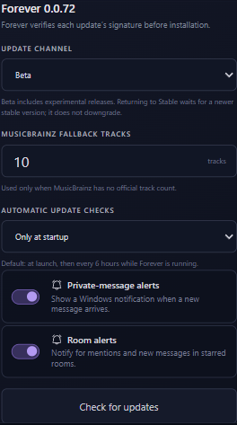

# Item 19 verification — 0.0.72

Verified locally on Windows, 2026-10-24:

- 168 frontend tests across 43 files; 273 Rust workspace tests.
- 10 release-policy/publication tests with simulated GitHub responses, including
  tauri-action asset URL normalization, missing artifacts, Stable/Beta isolation,
  SemVer ordering, recovery, and signing configuration failures.
- ESLint, TypeScript, production frontend build, lazy-bundle validation,
  Rust formatting, Clippy with warnings denied, version alignment, and diff checks.
- Both workflow files parse as YAML; release PowerShell steps parse successfully;
  Stable and signed Beta overlays validate against the installed Tauri CLI schema.
- Playwright against the Vite browser preview: Stable and six-hour defaults;
  switch to Beta and startup-only, navigate Home and return to Settings, and
  confirm both choices remain selected. The channel help explains returning to
  Stable without a downgrade. The screenshot was visually inspected.

The first frontend suite run exposed missing settings initialization in the test
helper and a lazy-route load timeout during concurrent compilation. The helper
now follows `main.tsx`; all 168 tests passed on the subsequent full run. The new
channel control also has an explicit accessible name and separate help description.

Browser evidence uses preview data. Native checks/install calls are mocked in
frontend tests; Rust tests cover settings persistence and version policy. No live
update installation, Azure certificate issuance, Authenticode-signed build, or
SmartScreen behavior was verified. Signing provisioning remains pending.
The repository workflow requires CI to complete asynchronously after pushing.
